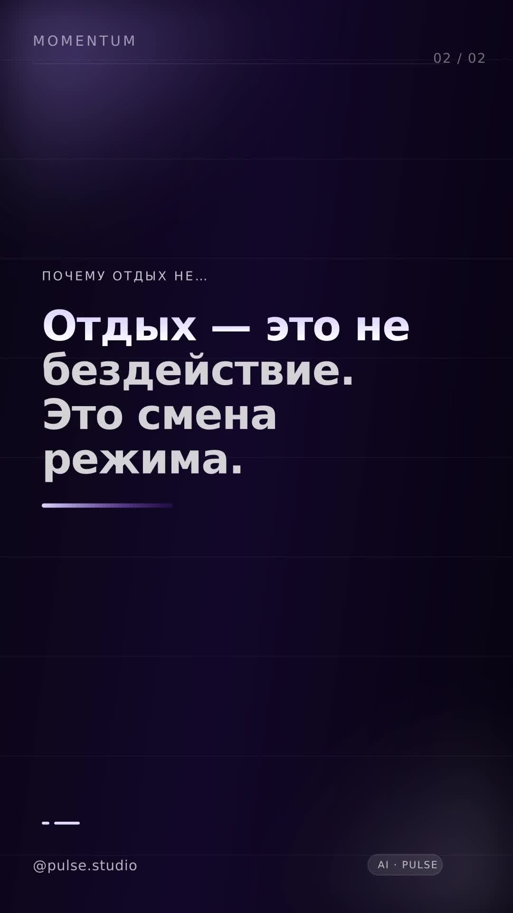
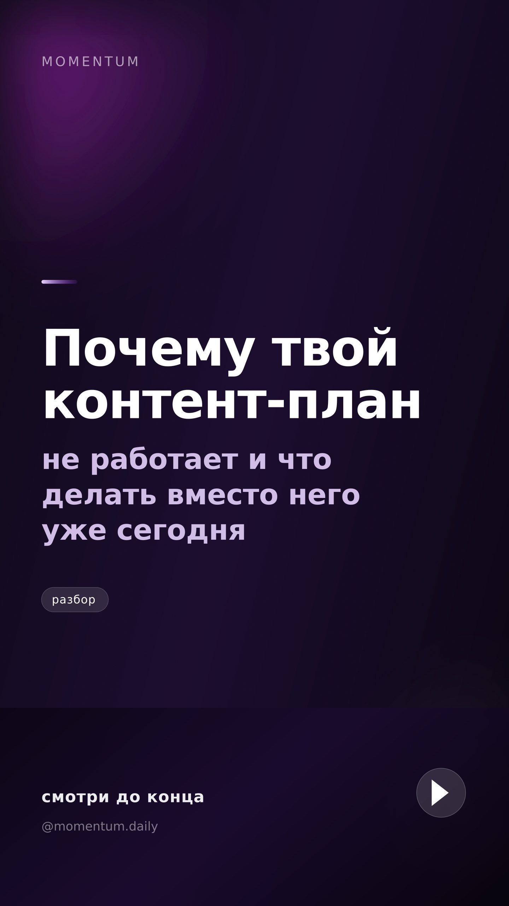

# Pulse

**Конвейер коротких видео: идея → сценарий → озвучка → видео → монтаж → публикация → аналитика.**
Одна панель, где видно каждый ролик и каждый рубль трафика.

Репозиторий — рабочая платформа, а не макет: `docker compose up` поднимает панель, конвейер,
очередь задач, планировщик и демо-историю за 21 день. В `docs/` — целевая микросервисная
архитектура на .NET/Postgres/RabbitMQ и план MVP на 4–6 недель.

> **С чего начать:** пошаговый гайд «от пустого сервера до первых денег без вложений» —
> [`docs/START.md`](docs/START.md): бесплатные ключи ИИ, бесплатная озвучка, бесплатный публичный
> адрес, регистрация приложений площадок по шагам и один клик до включения автопилота.

**v5 — рекламный контур: бренды платят внутри системы.** Кампании живут в базе: бюджет, модель оплаты
(фикс за ролик / CPM / CPA / бартер), дедлайн, дневной кэп и бриф. Pulse сам привязывает интеграции к
подходящим роликам, подставляет @бренд, хештеги кампании и обязательную маркировку «Реклама. ООО «…».
ИНН …. erid: …», не даёт опубликовать рекламу без erid (блокирующая проверка комплаенса) и считает
спонсорские деньги третьим каналом дохода — с дебиторкой, оплатами и ROI по каждому бренду.

**v4 — платформа, которая считает деньги и учится.** Расписание выбирается по окнам аккаунтов, пикам
площадок и собственным данным об охвате по часам; каждый ролик ещё до публикации получает прогноз
охвата, дохода, прибыли и ROI; A/B-тесты закрываются решением, и следующий ролик выходит сразу в
выигрышном стиле; веса вирусного скора пересчитываются на опубликованных роликах; автопилот сам
меняет темп проекта по ROI. Ролик теперь уходит на все площадки со свободной квотой, а не на одну.

**v3 — это уже не симуляция.** Панель реально собирает вертикальные ролики 1080×1920 @ 30 fps:
SVG-типографика → sharp → слойный монтаж в ffmpeg (фон + прозрачные текстовые слои),
на выходе mp4 с обложками A/B, метриками рендера и себестоимостью. Публикация умеет ходить
в реальные TikTok Content Posting API и Instagram Graph API: токены шифруются AES-256-GCM,
лимиты площадок читаются из их же API, при исчерпании квота переносится, при бане аккаунт уходит
в кулдаун. Перед публикацией каждый ролик проходит проверку правил площадок и вирусный скор,
а деньги считаются из фактических кликов и конверсий, а не из «красивых» констант.

```
┌────────────┐   ┌──────────┐   ┌────────┐   ┌─────────┐   ┌──────────┐
│  Идея      │ → │ Сценарий │ → │ Озвучка│ → │  Видео  │ → │  Монтаж  │
└────────────┘   └──────────┘   └────────┘   └─────────┘   └────┬─────┘
                                                               ↓
      ┌────────────┐   ┌────────────┐   ┌────────────┐   ┌──────────────┐
      │ Аналитика  │ ← │ Публикация │ ← │ Расписание │ ← │ Проверка (AI │
      │ CTR, охват │   │ Reels/TikTok│  │ и квоты    │   │ + человек)   │
      └────────────┘   └────────────┘   └────────────┘   └──────────────┘
```

---

## Как выглядит рендер

Кадр сцены и обложка, собранные кодом (без стоковых видео и чужих прав):

| Кадр сцены | Обложка A/B |
|-----------|-------------|
|  |  |

## Что нового в v15: проще — пять разделов вместо пятнадцати

| Блок | Что сделано |
|------|-------------|
| **Новый первый экран** | «Сегодня»: один следующий шаг крупным планом, прибыль за 30 дней, «путь к первым деньгам» из пяти условий и список того, что мешает зарабатывать — каждый пункт ведёт на нужный экран. Дашборд из десяти блоков убран: его работа разошлась по «Сегодня» и «Аналитике» |
| **Меню из пяти разделов** | Сегодня · Создать · Каналы · Деньги · Настройки. Внутри — вкладки, поэтому в сайдбаре пять строк вместо пятнадцати, а всё нужное остаётся в одном клике |
| **Старые адреса живы** | `#/money`, `#/analytics`, `#/queue` и остальные разрешаются в раздел и вкладку (`lib/nav.js`) — закладки и ссылки не ломаются. Smoke проверяет, что у каждой вкладки есть экран и что все 15 старых адресов работают |
| **Хостинг — в настройках** | карточка «Хостинг и диск» переехала из Студии в «Настройки → Хостинг»: это разовая проверка, а не ежедневный экран |
| **Починен запуск в Docker на Windows** | `docker-entrypoint.sh` падал с кодом 127, если файл склонирован с `core.autocrlf=true`: в shebang попадал `\r`, и ядро искало `/bin/sh\r`. Теперь `.gitattributes` держит LF для `.sh`, Dockerfile нормализует entrypoint (`sed` + проверка shebang), а smoke падает, если CRLF вернётся |

## Что нового в v14: хостинг без сюрпризов — Railway, самодиагностика, уборка диска

| Блок | Что сделано |
|------|-------------|
| **Railway одной командой** | `deploy/railway.sh`: создаёт проект, генерирует пароль и секрет, переносит бесплатные ключи ИИ из `.env`, подключает том к `/app/data`, деплоит и ждёт `/api/health`. В конце — адрес и пароль. Разбор по шагам и разбор сбоев — `docs/RAILWAY.md` |
| **Публичный адрес без настройки** | адрес берётся из `RAILWAY_PUBLIC_DOMAIN` / `RENDER_EXTERNAL_URL` / `FLY_APP_NAME` / `KOYEB_APP_NAME`, а `PULSE_PUBLIC_URL` остаётся ручным переопределением. Раньше на Railway Instagram получал «задайте PULSE_PUBLIC_URL» при доступной панели |
| **Самодиагностика хостинга** | `engine/deploy.js` + `GET /api/deploy/ready` + карточка «Хостинг и диск» в студии: подключён ли том (без него на Railway данные исчезают после рестарта), не дефолтный ли пароль, откуда публичный адрес, жив ли ffmpeg, сколько места осталось, включён ли автопилот. Каждая проблема — с готовой командой-решением |
| **Уборка медиа** | `engine/housekeeping.js`: старые файлы (по умолчанию старше 14 дней) удаляются раз в 6 часов, статистика и записи остаются. На Railway том Hobby — 5 ГБ, без уборки рендер падал на `ENOSPC` через месяц |
| **Docker без неожиданностей** | `tzdata` (иначе `TZ=Europe/Moscow` не работает), `tini` для корректного SIGTERM от ffmpeg, `stop_grace_period`, healthcheck через `/api/health`, явные `LABEL` и `STOPSIGNAL`. Два режима compose: локальный и `--profile tls` (Caddy сам получает сертификат, а `PULSE_PUBLIC_URL` собирается из `PULSE_DOMAIN`) |
| **Защита конфигов в CI** | smoke проверяет согласованность `railway.json`, `Dockerfile`, `docker-compose.yml` и `.dockerignore`: healthcheck существует в API, порт из окружения, том на месте, секреты не попадают в образ, оба профиля compose живы |

## Что нового в v13: ИИ-мозг на виду, проверка денежной ссылки, гайд «с нуля»

| Блок | Что сделано |
|------|-------------|
| **Стартовый гайд** | [`docs/START.md`](docs/START.md): от пустого сервера до первых денег без вложений. Бесплатные ключи ИИ с лимитами, бесплатная озвучка, бесплатный публичный адрес через `deploy/tunnel.sh`, регистрация приложений YouTube/TikTok/Instagram по шагам, первый автопилот и первая сводка в Telegram |
| **ИИ-мозг в настройках** | видно всю цепочку моделей: кто настроен, кто активен, сколько запросов съедено за сутки, какие лимиты и где взять бесплатный ключ. Одна кнопка — живая проверка модели с замером миллисекунд |
| **Честная себестоимость в UI** | на экране «Деньги» видно плановую себестоимость ролика (≈1 ₽ на бесплатном стеке) и пояснение, что именно бесплатно; тумблер «Я плачу за инфраструктуру» возвращает рыночный прайс |
| **Проверка ссылки продукта** | `POST /api/products/{id}/check` открывает ссылку глазами зрителя (GET, редиректы, таймаут 8 с) и выносит вердикт: ок / замечание / не работает. Битая ссылка = ролики без денег — теперь это видно в карточке продукта, а не через месяц по нулям |
| **Тест ИИ-контура** | `npm run test:ai` — 17 проверок на локальном мок-провайдере: выбор провайдера, разбор JSON, кэш (повторный запрос не тратит квоту), 429, мусорный ответ, утечка ключей, деградация без ключа. Идёт в CI, наружу ничего не отправляет |

## Что нового в v9: PulseStudio — реальные аккаунты, нейро-сериалы, свои продукты

| Блок | Что сделано |
|------|-------------|
| **Вход в каналы одной кнопкой** | OAuth (authorization code + PKCE) для YouTube, TikTok и Instagram прямо из карточки аккаунта. Токен сохраняется зашифрованным, `refresh_token` продлевает его автоматически за 3 минуты до истечения — вставлять токен руками больше не нужно (но можно) |
| **Панель честно говорит, чего не хватает** | для каждой площадки видно, какие переменные окружения добавить и какой **точный** redirect URI вписать в кабинет разработчика |
| **Экран «Студия»** | чек-лист запуска: подключить канал → задать тему → добавить продукт → запустить контент → перейти в live. Процент готовности и «следующий шаг» считаются из реальных данных |
| **Тема канала** | у аккаунта есть тема, язык, визуальный стиль и персона. Генератор пишет под тему канала, а не «в среднем»: зомби-канал и нейро-канал не смешиваются |
| **Нейро-фото-ряд сериалов** | кадр на каждую сцену из Flux (Pollinations, без ключа, 0 ₽) или Cloudflare Workers AI (10k нейронов/день бесплатно). Кэш по промпту, троттлинг, потолок кадров, откат на процедурную плашку — серия выйдет даже при отказе провайдера |
| **Автопилот сериала** | серии сочиняются на 1–6 выпусков вперёд каждые 10 минут; при включённом «собирать без меня» сервер сам ставит озвучку и рендер в очередь. В UI видно, что будет дальше |
| **Свой продукт в трёх режимах** | «только видео», «только описание», «везде» + галочка «в каждом ролике» (отключает дозирование 80/20). Маркировка рекламы остаётся обязательной |

## Что нового в v8.3: запуск на хостинге и защита публичной панели

| Блок | Что сделано |
|------|-------------|
| **Деплой одной командой** | `deploy/install.sh` для Oracle Always Free и любого VPS: Docker, своп, `.env` со случайными паролем и секретом, сборка, запуск, проверка `/api/health` |
| **Конфиги площадок** | `railway.json` (Dockerfile + healthcheck), `render.yaml` (blueprint), `fly.toml` (том + HTTP-сервис), обновлённый `docker-compose.yml` |
| **Порт как у платформы** | приложение читает `PORT` (Railway/Render/Fly), затем `PULSE_PORT` — раньше слушало только свой |
| **Секреты не из репозитория** | `PULSE_SECRET` генерируется и хранится в томе; на облаке пароль входа случайный, печатается в лог один раз и переживает рестарт |
| **ffmpeg на любой архитектуре** | `PULSE_FFMPEG_PATH` → installer → системный бинарь; в образ ставится apt-ffmpeg, поэтому ARM (Oracle Ampere) тоже рендерит |
| **Честная рамка demo** | в панели видна полоса «Демо-режим: реальных выплат нет»; в `live` она исчезает |
| **Бэкапы** | `npm run backup` — консистентный дамп SQLite через `db.backup()`, хранит 14 копий, знает про медиа |
| **CI** | GitHub Actions: сборка панели, 74 проверки smoke и сборка Docker-образа на каждый push |

## Что нового в v8: сериалы — длинные истории 8–20 минут

| Блок | Что сделано |
|------|-------------|
| **Сериал как продукт** | новая вкладка «Сериалы»: создаёте сериал одним названием и жанром — движок строит **библию** (мир, правило, цена, секрет сезона, три героя с раной и тайной), **арку сезона** на 4–8 серий и **сценарий первой серии** |
| **Сценарий по 12 битам** | холодное открытие → напоминание → завязка → три акта → перелом → финал → обрыв. Крючок в конце серии сильнее хука в начале: именно он возвращает зрителя через неделю |
| **Хронометраж из речи** | бюджет слов считается от цели (цель × 2.35 слова/с), на 600/780/900/1200 с длительность сходится к цели в пределах 0.3%, темп держится 143–148 слов/мин |
| **Мид-роллы на границах глав** | реклама не рвёт кадр, а таймкоды в описании совпадают с видео: доход растёт, удержание не падает |
| **Аудит оригинальности** | 7 проверок под правила 2026 (нарратив, арка, связность, маркировка ИИ, визуал, длина, отсутствие шока) + сравнение с соседними сериями: дословный повтор ≥ 60% — стоп, вердикт «риск демонетизации» |
| **Фото-ряд 16:9** | свой кадр на каждую сцену: 9 типов локаций, 4 крупности, свет, туман, зерно, виньетка. Каждый план держит свою длительность (concat), а не «один фон на 15 минут» — за такое снимают монетизацию |
| **Озвучка секциями** | серия режется по лимиту TTS (≤3200 знаков), звук склеивается в один трек, тайминг сцен пересчитывается по реальной длине речи |
| **Субтитры и обложки** | субтитры отдельным слоем по чанкам; обложки A/B/C 1280×720 с заголовком, номером серии и меткой ИИ |
| **Публикация как сериал** | серия уходит обычным видео (не Shorts), плейлист сезона создаётся сам, серия добавляется в него: автоплей и порядок — главный механизм удержания. В ответе — чек-лист: отметка «синтетический контент», главы с 0:00, Shows |
| **Нарезки для трафика** | вертикальные клипы 15–60 с из сильнейших сцен: Shorts приводит нового зрителя, сериал удерживает |
| **Деньги длинного формата** | RPM жанра (120–340 ₽/1000), сценарии 5k/15k/50k/150k просмотров, часы до YPP, окупаемость серии, себестоимость по факту знаков и минут рендера |
| **Выпуск без участия** | «В расписание» → серия уходит задачей `series.publish` в общей очереди и публикуется сама в `publish_at` (тумблер в настройках). Ошибка загрузки возвращает серию в проверку, а не зацикливает планировщик |
| **Нарезки в конвейер** | «В очередь» превращает сцены серии в обычные ролики Reels/TikTok/Shorts с CTA на сериал: дальше работают креатив, комплаенс, лимиты площадок и аналитика |
| **Деньги в общей картине** | `GET /api/money` отдаёт блок `longform`: серии, просмотры, доход, себестоимость, часы просмотра, средний RPM и сколько часов осталось до 4000. В «Деньгах» — карточка «Длинные серии» |
| **База знаний про длинный формат** | в «Базе знаний» отдельный блок: длина серии и мид-роллы, RPM против Shorts, структура сезона, норма падения N+1/N ≥ 80%, оформление плейлиста и Shows, оригинальность, маркировка ИИ |

---

## Что нового в v7: платформа сама делает ролики

| Блок | Что сделано |
|------|-------------|
| **Студия** | отдельная вкладка «Роста»: выбираете бренд, площадку и уровень продажи — движок собирает **три готовых ролика** (хук, сцены, описание, обложка, закреплённый комментарий) и показывает, почему лучший именно этот: общий скор, хук, вирусность, удержание, комплаенс |
| **Хуки под окно свайпа** | шаблоны сокращены до 3–5 слов (1.2–2.0 с): прежние 7–12 слов физически не успевали до свайпа на TikTok (1.3 с) и Shorts (2.1 с). Плюс бонус за то, что хук называет именно вашу тему |
| **Описание под каждую площадку** | TikTok — ссылка в профиле и закреплённый комментарий (в описании ссылки не кликабельны), Reels — кликабельная ссылка с UTM, Shorts — короткое описание и 5 тегов. UTM ставится под площадку: `utm_source=tiktok\|reels\|youtube`, `utm_content=<ideaId>` |
| **Продажа по надобности** | правило 80/20 считает долю продающих роликов за 14 дней и выбирает `direct / soft / none`. Новый проект начинается с пользы, «перепроданный» отдыхает от CTA. Решение фиксируется на ролике и не пересчитывается при публикации |
| **Публикация берёт готовый текст** | описание нужной площадки, а не переупаковка базового: раньше в тексте оказывались две ссылки и два блока тегов. Маркировка «Реклама»/ИИ — ровно один раз |
| **Карточка ролика** | показывает паспорт креатива: хук, оценки, предупреждения, альтернативные хуки и кнопку «Пересобрать креатив» без пересъёмки |
| **Очередь не тормозит планировщик** | рендер идёт отдельно от расписания и аналитики, у задачи есть таймаут, `drain` отвечает сразу и возвращает зависшие задачи в работу |
| **Длина под деньги** | 16–42 с для Reels/Shorts и до 65+ с для TikTok Creator Rewards (платит только за видео > 60 с): длинный ролик набирается сценами, а не «зависшими» титрами, а если лимит рендера ниже — пакет честно предупредит |
| **Честные отчёты** | «за 30 дней» — это правда 30 дней (раньше окно показывало всю историю), а демо-данные больше не помечают опубликованные ролики как заблокированные |

---

## Что нового в v6: рост на нескольких каналах

| Блок | Что сделано |
|------|-------------|
| **YouTube Shorts** | полноценный канал наравне с TikTok и Reels: `videos.insert` с resumable-загрузкой, `youtube.upload`, приватность до аудита проекта, свои лимиты полей (title ≤ 100, description ≤ 5000 **байт**) |
| **Портфель аккаунтов** | 8 аккаунтов в демо (3 бренда × Reels/TikTok/Shorts), у каждого подписчики, квота, удержание, `health` и **одно следующее действие** — «продолжать темп», «менять хуки», «дать отдых», «прогрев» |
| **Аккаунт = бренд** | у аккаунта есть проект: ролики FitFlow не уходят в аккаунт Momentum. Универсальные аккаунты можно оставить без привязки |
| **Лаборатория хуков** | 7 шаблонов × площадка: «почему не работает», «одна ошибка», «результат вперёд», петля. Оценка по паттернам + проверка, успевает ли фраза прозвучать до свайпа (TikTok 1.3 с, Shorts 2.1 с) |
| **Удержание** | 8 проверок ролика (хук, длительность, петля, темп сцен, описание, теги) и прогноз досмотра против цели площадки; теги считаются реальные, Shorts 3–5, TikTok/Reels 5–8 |
| **Гейт публикации** | один вердикт `go / fix / block` по комплаенсу, удержанию, вирусному скору, прогнозу охвата и квоте — тот же, что видит автопилот |
| **Путь к деньгам** | YPP (ранний доступ и полный), TikTok Creator Rewards, бренды, свой продукт: прогресс по каждому условию и ETA по фактической скорости. Региональные ограничения показаны честно |
| **Честность цифр** | неаудированный YouTube грузит только приватно; неаудированный TikTok — `SELF_ONLY`; Creator Rewards недоступна РФ — всё это написано на экране, а не спрятано |
| **План на неделю** | календарь: день, время, аккаунт, тема, формат и готовый хук с прогнозом охвата и дохода. Слоты строятся из лучших часов, фактически работающих форматов и квот аккаунтов |
| **Аудит платформы** | 10 проверок «что мешает охвату и деньгам» с ценой вопроса и кнопкой действия: приватные Shorts, SELF_ONLY в TikTok, аккаунты без API, простой, erid, RPM, длина роликов под Creator Rewards |
| **База знаний** | лимиты API и полей, окно хука, идеальная длина, что демотивируется, пороги монетизации по странам — числа берутся из тех же модулей, что и проверки |

---

## Что нового в v2

| Блок | Что сделано |
|------|-------------|
| **Рендер** | настоящий mp4: `fontkit` (текст контурами) → `sharp` → `ffmpeg` (zoompan, fade, libx264, aac). Файл и обложки A/B раздаются через `/media/*`, качаются и играются в браузере |
| **Проверка правил** | `engine/compliance.js`: обещания дохода, медицинские обещания, кликбейт, маркировка рекламы, лимиты описаний. Блокирующие пункты останавливают автопубликацию |
| **«Залетит ли»** | `engine/viral.js`: 6 факторов с весами, порог `min_viral_score`, конкретные рекомендации вместо магического числа |
| **Лимиты площадок** | TikTok 15 постов/24 ч, 6 init/мин, неаудированный клиент = `SELF_ONLY`; Instagram 50 API-постов в скользящем окне. Фактическое потребление — на экране «Прозрачность» |
| **Деньги** | `engine/money.js`: доход = RPM + продажи по ссылкам, расход = себестоимость роликов, ROI и прибыль по ролику/проекту/площадке |
| **Трекинг** | короткая ссылка `/t/<token>`, postback `POST /api/postback` (идемпотентно по `external_id`), клики и конверсии в БД |
| **Дизайн** | экран «Деньги» с воронкой и разрезами, экран «Прозрачность» с проверками и лимитами, медиа-превью и панель проверки в карточке ролика, быстрая правка описания |

## Куда это поставить

| Вариант | Цена | Диск | Когда выбирать |
|---|---|---|---|
| **Railway** | $5/мес (входит $5 кредита), пробный $5 на 30 дней | том подключается отдельно | самый быстрый запуск: `bash deploy/railway.sh` → адрес и пароль в конце. Пошагово — [`docs/RAILWAY.md`](docs/RAILWAY.md) |
| **Oracle Cloud Always Free** | 0 ₽ навсегда | 200 ГБ постоянный | «бесплатно и надолго»: 4 ARM-ядра, 24 ГБ RAM |
| Свой VPS + `--profile tls` | от ~$4–6/мес | есть | свой домен, HTTPS через Caddy, полный контроль |
| Render / Koyeb free | 0 ₽ | **временный** | посмотреть интерфейс; данные исчезают после перезапуска |

**Railway одной командой** (CLI сам создаст проект, том и переменные):

```bash
bash deploy/railway.sh
```

**Два режима Docker Compose** — ровно два, без «зависит от настроения»:

```bash
docker compose up -d --build                     # локально/на VPS: http://localhost:8080
docker compose --profile tls up -d --build       # + Caddy и HTTPS: https://PULSE_DOMAIN
```

Публичный адрес на Railway/Render/Fly подставляется сам (`RAILWAY_PUBLIC_DOMAIN` и аналоги):
Instagram и TikTok скачивают видео по ссылке, и дублировать домен в `PULSE_PUBLIC_URL` не нужно.
Проверить готовность хостинга можно в **Студии → «Хостинг и диск»** или через `GET /api/deploy/ready`:
том, пароль, публичный адрес, ffmpeg, место на диске и автопилот — с подсказкой «что сделать».

Одна команда на чистом сервере (Ubuntu/Debian, Oracle, VPS):

```bash
curl -fsSL https://raw.githubusercontent.com/ogSulem/pulse/main/deploy/install.sh | sudo bash
```

Скрипт поставит Docker, сгенерирует пароль и секрет, соберёт образ, поднимет контейнер и
напечатает адрес и пароль. Домен и HTTPS: `sudo PULSE_DOMAIN=pulse.example.com bash deploy/install.sh`.

**Полная инструкция:** [`docs/DEPLOY.md`](docs/DEPLOY.md) — Railway по шагам, бесплатный Oracle,
переезд, бэкапы, переменные окружения и честный путь к первым деньгам.

### Вручную через Docker Compose

```bash
git clone <repo-url> pulse && cd pulse
cp .env.example .env
nano .env                      # обязательно смените PULSE_PASSWORD и PULSE_SECRET
docker compose up -d --build
```

Открыть `http://<ip-сервера>:8080`, ввести пароль из `.env`.
Первый запуск сам создаёт базу и демо-данные: 3 проекта, 5 аккаунтов, 21 день публикаций и живую очередь.
Дальше конвейер сам доводит ролики до файла: в логах появится `Видео собрано: 1080×1920, 1.2 МБ, 16 с`.
Качество задаётся пресетом `PULSE_RENDER_QUALITY` (`high` по умолчанию = 1080×1920 @ 30 fps).
Готовые файлы лежат в `./data/media`, поэтому каталог `data` должен принадлежать пользователю контейнера:

```bash
sudo chown -R 1000:1000 data
```

```bash
docker compose logs -f pulse            # логи
docker compose restart pulse            # перезапуск
docker compose down                     # остановка (данные в ./data сохраняются)
docker compose exec pulse npm run backup  # консистентный бэкап базы в data/backups
```

**HTTPS** (профиль `tls`, нужен домен с A-записью на сервер):

```bash
echo "PULSE_DOMAIN=pulse.example.com" >> .env
docker compose --profile tls up -d --build
```

`PULSE_PUBLIC_URL` при этом можно не задавать: entrypoint соберёт его из `PULSE_DOMAIN`.
Caddy сам получит сертификат, а Pulse отдаст медиа по `https://<домен>/media/...` — именно
этот адрес забирает Instagram.

### Локально без Docker

```bash
npm install
npm run build          # собрать панель
npm start              # http://localhost:8080  (пароль: pulse)
```

Разработка с hot-reload: `npm run dev:api` и `npm run dev:web` (Vite на 5173, проксирует `/api`).

---

## Что умеет

### Конвейер

- **Идеи и сценарии** — Content Brain генерирует темы под нишу и продукт, раскладывает на сцены
  (текст + визуал + секунды), считает риск. Всё правится вручную или быстрыми правками.
- **Генерация видео** — через адаптеры (NVIDIA NIM/Cosmos, Runway, Luma, Pika, Replicate).
  Конвейер знает только контракт `submit → externalId → poll`, поэтому движок меняется одним файлом.
- **Сборка** — тайминги, субтитры, TTS-дорожка, логотип, обложка 9:16; длительность и стиль — из шаблона.
- **Описания и хештеги** — отдельные наборы под Reels и TikTok, ссылка с UTM, правка перед публикацией.
- **Постинг** — расписание по слотам, пауза, перенос, «опубликовать сейчас», отмена, A/B-вариант.
- **Продвижение продукта** — шаблоны «обзор», «до/после», «проблема → решение», «кейс», «мем»;
  UTM-конструктор со live-превью ссылки.
- **Реклама брендов** — кампании с бюджетом, моделью оплаты (`fixed` / `cpm` / `cpa` / `barter`),
  дедлайном и дневным кэпом; автораздача по свободным роликам, привязка вручную в карточке ролика,
  маркировка ОРД (erid) и пометка «Реклама» в описании, учёт выходов, начислений, оплат и дебиторки.
- **Аналитика** — охват, лайки, репосты, подписчики, клики и CTR; разрезы по проектам, форматам и темам;
  сравнение A/B; топ роликов; экспорт CSV и полный JSON-бэкап.
- **Контроль** — статусы (в очереди / в генерации / на проверке / запланирован / опубликован / ошибка),
  прогресс этапов, журнал действий, восстановление очереди.

### Аккаунты и устойчивость

- Несколько аккаунтов на площадку (TikTok, Instagram Reels, YouTube Shorts), у каждого — квота,
  минимальный интервал, окно публикаций, прогрев и подписчики из API площадки.
- Нагрузка уходит на аккаунт с наибольшим остатком квоты; при перегрузе задача **переносится**, а не форсируется.
- Статусы `healthy` / `warmup` / `cooldown` / `blocked`: блокировка одного аккаунта не останавливает конвейер.
- Слоты с джиттером ±12% — никаких публикаций «ровно по секундам».
- Риск-скоринг текста + режим ручной проверки для спорных роликов.

### Надёжность

- Очередь задач в БД с `lease`, счётчиком попыток и экспоненциальным backoff (10с → 40с → 160с), dead-letter.
- Восстановление после падения: просроченные задачи возвращаются, «зависшие» ролики перезапускаются.
- Все операции — через очередь, поэтому процесс можно перезапускать в любой момент.
- Пароль панели + HMAC-сессия, rate limit на вход, секреты — только в окружении.

---

## Экраны панели: пять разделов, а не пятнадцать

Меню отвечает на вопросы, которые человек реально задаёт, а не на структуру кода.
Внутри раздела — вкладки, поэтому в сайдбаре всегда пять строк.

| Раздел | Вкладки | Что внутри |
|--------|---------|-----------|
| **Сегодня** | Сейчас | один следующий шаг крупным планом · прибыль за 30 дней · «путь к первым деньгам» из 5 условий · что мешает зарабатывать (с действием) · конвейер и события |
| **Создать** | Студия · Очередь · Расписание · Сериалы · Темы | запуск по шагам и автопилот · ролики со стадиями и подтверждениями · слоты недели · библия, сезон, рендер 16:9 и нарезки · проекты и библиотека тем |
| **Каналы** | Рост · Аккаунты · Правила | портфель, хуки, удержание, план, база знаний площадок · квоты и подключение TikTok / Reels / Shorts · что автоматизировано и где нужен человек |
| **Деньги** | Итоги · Аналитика · Реклама · Продукты | доход по трём каналам, себестоимость по факту, ROI каждого ролика · охваты, CTR, A/B, экспорт · бренд-кампании и маркировка ОРД · продукты, UTM и проверка ссылки |
| **Настройки** | Основное · Хостинг · Журнал | режим, провайдеры, правила · том, адрес, пароль, место на диске · события и аудит |

Почему так:

- **«Сегодня» — единственный экран, который нужен каждый день.** Раньше это был дашборд из десяти
  блоков: конвейер, KPI, деньги, проверки, графики, лучшие ролики, события, нагрузка аккаунтов.
  Всё полезное, но утром нужен ответ на один вопрос — «что сделать, чтобы это заработало». Теперь
  сверху один шаг, ниже деньги, ниже пять условий и список того, что мешает (каждый пункт — ссылка
  на нужный экран).
- **Хостинг переехал из Студии в Настройки.** Это разовая проверка, а не ежедневный экран; рядом
  с «Запустить конвейер» она только отвлекала. Когда что-то ломается, карточка «Хостинг и диск»
  показывает проблему и готовое действие.
- **Старые адреса живы.** `#/money`, `#/analytics`, `#/queue` и остальные разрешаются в раздел и
  вкладку (`web/src/lib/nav.js`), поэтому закладки и ссылки из писем не ломаются, а меню остаётся
  коротким. Smoke проверяет, что у каждой вкладки есть экран и что все старые адреса работают.

Тёмная тема по умолчанию, светлая — переключателем в сайдбаре. Интерфейс адаптирован под телефон.

---

## Стек

| Слой | В этом репозитории | Целевой production |
|------|--------------------|--------------------|
| Панель | React 19 + Vite, собственный CSS-дизайн-система | тот же SPA / Blazor |
| API | Node.js 22 + Express 5, REST | .NET 8 Web API (minimal APIs) + Swagger |
| Данные | SQLite (WAL), схема и запросы без ORM | PostgreSQL 16 + EF Core 8 (Npgsql) |
| Очередь | таблица `jobs` с lease и retry | RabbitMQ (quorum) + MassTransit |
| Планировщик | интервал в процессе + восстановление | Quartz.NET / отложенные сообщения |
| Медиа | метаданные в БД, обложки генерируются SVG | S3/MinIO + ffmpeg worker |
| Секреты | переменные окружения | Vault / Docker secrets |
| Деплой | Docker Compose + Caddy (профиль `tls`) | Compose → k3s |

Подробно: [`docs/ARCHITECTURE.md`](docs/ARCHITECTURE.md) — компоненты, поток данных, маппинг на ваш
BFF/API/Postgres, безопасность, антиблок-архитектура, риски.

---

## Структура репозитория

```
pulse/
├─ server/src/
│  ├─ core/            # БД, очередь, журнал, утилиты
│  ├─ engine/          # конвейер, реклама (ads.js), деньги, прогноз, комплаенс, Content Brain
│  ├─ providers/       # адаптеры LLM / видео / TTS / публикации (demo + live)
│  ├─ modules/api.js   # REST API
│  ├─ seed/            # демо-данные
│  └─ index.js         # сервер, статика SPA, планировщик
├─ web/src/
│  ├─ pages/           # 15 экранов панели
│  ├─ components/      # дизайн-система, иконки, графики, карточка ролика
│  ├─ lib/             # API-клиент и форматирование
│  └─ styles.css       # токены, тёмная/светлая тема, компоненты
├─ docs/
│  ├─ START.md         # гайд: от пустого сервера до первых денег без вложений
│  ├─ RAILWAY.md       # Railway: скрипт/дашборд, том, домен, откаты, сбои
│  ├─ DEPLOY.md        # хостинг: Oracle Always Free, Railway, VPS, домен
│  ├─ ARCHITECTURE.md  # архитектура, стек, безопасность, риски
│  ├─ DATABASE.md      # схема БД, DDL Postgres, EF Core
│  ├─ API.md           # эндпоинты и примеры curl
│  └─ PLAN.md          # MVP за 4–6 недель
├─ deploy/
│  ├─ Caddyfile        # HTTPS для docker compose --profile tls
│  ├─ tunnel.sh        # бесплатный публичный https-адрес (Cloudflare Quick Tunnel)
│  ├─ railway.sh       # Railway: проект, том, переменные, деплой одной командой
│  └─ install.sh       # установка на чистый сервер одной командой
├─ Dockerfile · docker-compose.yml · .env.example
├─ railway.json · render.yaml · fly.toml   # конфиги площадок
├─ .github/workflows/ci.yml                # сборка + 74 проверки smoke на каждый push
└─ data/               # SQLite, медиа, бэкапы (том контейнера, в git не попадает)
```

---

## Конфигурация

Все параметры — в `.env` (см. `.env.example`).

| Переменная | По умолчанию | Смысл |
|------------|--------------|-------|
| `PULSE_PASSWORD` | `pulse` локально; на облаке генерируется | пароль входа в панель — **смените** |
| `PULSE_SECRET` | — | ключ подписи сессий (`openssl rand -hex 32`) |
| `PORT` / `PULSE_PORT` | `8080` | порт: `PORT` приоритетнее (его передают Railway/Render/Fly) |
| `PULSE_DATA_DIR` | `./data` | каталог данных: база, медиа, бэкапы, секрет |
| `PULSE_MODE` | `demo` | `demo` (симуляция) или `live` (реальные API и публикация) |
| `PULSE_SECRET` | — | ≥8 символов: подпись сессий **и** ключ AES-256-GCM для токенов площадок |
| `PULSE_PUBLIC_URL` | — | публичный адрес, по нему Instagram забирает `video_url`/`cover_url` |
| `PULSE_RENDER_QUALITY` | `high` | пресет рендера: `high` (1080×1920, crf19) / `balanced` / `fast` (720×1280) |
| `PULSE_RENDER_MAX_SEC` | `42` | максимальная длина ролика. `42` — оптимум Reels/Shorts; `65` — если нужен TikTok Creator Rewards (платит только за видео > 60 с) |
| `PULSE_TZ` | `Europe/Moscow` | часовой пояс планировщика |
| `PULSE_DB_PATH` | `/app/data/pulse.db` | путь к базе |
| `VIDEO_PROVIDER` | `nvidia` | `nvidia` · `runway` · `luma` · `pika` · `replicate` |
| `TTS_PROVIDER` | `edge` | `edge` (бесплатно, без ключа) · `elevenlabs` · `openai` · `system` |
| `TTS_VOICE_ID` | `ru-narrator` | `ru-narrator` · `ru-female` · `en-narrator` · `en-female` или имя голоса Edge |
| `PULSE_AI` | `on` | включает ИИ везде: идеи, сценарии, описания, библия сериалов, режиссура кадра |
| `NVIDIA_API_KEY` | — | бесплатный ключ [build.nvidia.com](https://build.nvidia.com): LLM (~40 rpm) и видео Cosmos |
| `GEMINI_API_KEY` / `GROQ_API_KEY` / `CEREBRAS_API_KEY` / `OPENROUTER_API_KEY` / `MISTRAL_API_KEY` / `OPENAI_API_KEY` | — | цепочка LLM-фолбэков; достаточно одного ключа |
| `PULSE_OLLAMA` + `OLLAMA_BASE_URL` | `off` | своя Ollama на VPS: ИИ без интернета и без оплаты |
| `PULSE_LLM_ORDER` / `PULSE_LLM_PROVIDER` | — | жёсткий порядок или один провайдер: `gemini,groq` |
| `NVIDIA_VIDEO_MODEL` | `nvidia/cosmos-1.0-diffusion-7b-text2world` | модель видео NVIDIA NIM |
| `NVIDIA_API_KEY`, `RUNWAY_API_KEY`, `LUMA_API_KEY`, `PIKA_API_KEY`, `REPLICATE_API_TOKEN`, `ELEVENLABS_API_KEY` … | — | остальные ключи live-режима |

### Заработать без вложений: что нужно на самом деле

Платформа не требует ни одного платного сервиса на старте:

1. **Тексты** — бесплатный ключ NVIDIA (или GitHub Models: обычный GitHub-токен с правом `models:read`,
   либо Gemini/Groq как страховка). Цепочка перебирает их и не падает при лимите.
2. **Озвучка** — Edge TTS, ключ не нужен, длина не ограничена.
3. **Кадры** — Flux через Pollinations, ключ не нужен.
4. **Публичный адрес** — `bash deploy/tunnel.sh`: Cloudflare Quick Tunnel выдаёт https-ссылку без домена
   (без неё Instagram не сможет забрать видео).
5. **Один клик** — «Студия → Включить полный автопилот»: ежедневные ролики, серии по расписанию,
   раздача кампаний, маркировка. Рядом — блокеры, которые мешают заработать (аккаунт, продукт, тема).
6. **Деньги** — свой продукт по ссылке с UTM, CPA/партнёрские ссылки, бренд-интеграции.
   Платформа считает клики, конверсии и начисления: экран «Деньги» — это факт, а не прогноз.
7. **Проверка** — «Студия → Проверить публичный адрес» делает реальный запрос снаружи и проверяет
   отдачу `/media`, потому что именно по этой ссылке площадки скачивают видео.
8. **Контроль** — бесплатный бот в Telegram (`PULSE_TELEGRAM_BOT_TOKEN`, `PULSE_TELEGRAM_CHAT_ID`)
   раз в сутки присылает сводку: что вышло, просмотры, деньги и что сломалось. Без него
   «тихо упало» выглядит как «всё хорошо».

Себестоимость считается **по факту провайдеров**, а не по прайсу из настроек: на бесплатном стеке
ролик стоит около рубля (только процессор), а не 66 ₽. Если вы платите за GPU-сервер —
включите `powered_by_me = 1`, и расчёт вернётся к ставкам из настроек.

### ИИ бесплатно за пять минут

Pulse не требует платных ключей, чтобы писать сценарии и озвучивать видео:

1. Возьмите бесплатный ключ на [build.nvidia.com](https://build.nvidia.com) (без карты, ~40 запросов в минуту)
   и впишите в `.env`: `NVIDIA_API_KEY=nvapi-…`, `PULSE_AI=on`, `PULSE_MODE=live`.
2. Озвучка уже бесплатна: `TTS_PROVIDER=edge` — нейронные голоса Microsoft (Dmitry/Svetlana) без ключа,
   без лимитов и без оплаты за символы.
3. Хотите страховку от лимитов — добавьте второй ключ: `GEMINI_API_KEY` или `GROQ_API_KEY`.
   Pulse перебирает цепочку и берёт первый доступный, ответы кэширует в `data/ai-cache/` на 7 дней.
4. Совсем без внешних API — своя модель на VPS: `PULSE_OLLAMA=on`, `OLLAMA_BASE_URL=http://ollama:11434`.
5. Проверить, что всё работает: «Настройки → ИИ-движок → Проверить ИИ живым запросом»
   (или `curl -X POST localhost:8080/api/ai/test`).

Где Pulse использует ИИ: генератор идей с оценкой вирусности, сценарий короткого ролика,
описание и теги под каждую площадку, режиссура кадра для нейро-фото-ряда, библия сериала,
переписывание серии «как рассказчик», названия и хуки A/B.

**Demo-режим** полностью рабочий: генерация, рендер и постинг симулируются с реалистичными задержками,
метрики растут по кривой охвата. **Live-режим** включает адаптеры провайдеров и официальные API площадок
(Meta Graph / TikTok Content Posting / **YouTube Data API v3**); ключи не покидают сервер.

### YouTube Shorts: что нужно для реальной публикации

1. Проект в Google Cloud → включить **YouTube Data API v3** → OAuth scope `youtube.upload`.
2. Пройти аудит проекта: до него API разрешает только приватные загрузки. В «Настройках» есть
   переключатель «Проект Google прошёл аудит» — пока он выключен, Pulse ставит `private`.
3. Подключить аккаунт на экране «Аккаунты» → «Подключить API», вставить refresh/access token.
   Channel ID можно не указывать — канал определится по токену.
4. Отдельного Shorts-API нет: вертикальное видео ≤ 3 минут YouTube считает Shorts автоматически.
   Квота — 100 `videos.insert` в сутки на проект (с 01.06.2026), Pulse держит свой потолок ниже.

### TikTok Creator Rewards и РФ

Программа требует 10 000 подписчиков, 100 000 просмотров за 30 дней, personal-аккаунт и доступна
только в US, UK, DE, FR, JP, KR, MX, BR. Для РФ-аккаунта деньги дают бренд-интеграции и свой
продукт — экран «Рост» пишет это прямо, вместо процента «готово» без оговорок.

---

## API за минуту

```bash
TOKEN=$(curl -s -X POST localhost:8080/api/auth/login \
  -H 'Content-Type: application/json' -d '{"password":"pulse"}' | jq -r .token)

PROJECT=$(curl -s -X POST localhost:8080/api/projects \
  -H "Authorization: Bearer $TOKEN" -H 'Content-Type: application/json' \
  -d '{"name":"Momentum","niche":"привычки и продуктивность","product_url":"https://momentum.app"}' | jq -r .id)

curl -s -X POST localhost:8080/api/pipeline/run \
  -H "Authorization: Bearer $TOKEN" -H 'Content-Type: application/json' \
  -d "{\"projectId\":\"$PROJECT\",\"count\":3}"

curl -s localhost:8080/api/pipeline/status -H "Authorization: Bearer $TOKEN" | jq .byStatus
curl -s "localhost:8080/api/analytics/overview?days=14" -H "Authorization: Bearer $TOKEN" | jq .totals

# реклама: кампании, деньги и раздача по роликам
curl -s localhost:8080/api/ads/overview -H "Authorization: Bearer $TOKEN" | jq .totals
curl -s -X POST localhost:8080/api/campaigns -H "Authorization: Bearer $TOKEN" -H 'Content-Type: application/json' \
  -d '{"brandName":"Nordwind","name":"Зимняя капсула","model":"fixed","budget":180000,"rate":45000,
       "postsTarget":4,"erid":"2VtzqxP9dKf","mention":"@nordwind","endsAt":"2026-12-01"}' | jq .id
curl -s -X POST localhost:8080/api/ads/autofill -H "Authorization: Bearer $TOKEN" | jq .filled
```

Полный список и примеры — [`docs/API.md`](docs/API.md).

---

## Эксплуатация

```bash
# бэкап: два независимых способа
docker compose exec pulse node -e "1" >/dev/null
cp -r data/backups ./backups-$(date +%F)        # файл SQLite + WAL
curl -s "localhost:8080/api/backup?token=$TOKEN" -o pulse-backup.json

# восстановление
docker compose down
cp backups-2026-10-21/pulse.db data/pulse.db
docker compose up -d

# проверка здоровья
curl -s localhost:8080/api/health
docker compose ps
```

**Самопроверка после обновления** (не трогает рабочую базу — гоняет всё на временной копии):

```bash
npm run smoke
# ✓ база и миграции · ✓ демо-данные · ✓ рендер 1080×1920 @ 30 fps · ✓ сборка mp4 и обложек
# ✓ правила площадок · ✓ вирусный скор · ✓ деньги · ✓ прозрачность
# ✓ шифрование токенов (AES-256-GCM) · ✓ адаптеры публикации · ✓ очередь переживает рестарт
# ✓ зависшие ролики возвращаются в очередь (без дублей)
# ✓ умное расписание · ✓ прогноз прибыли · ✓ A/B закрывается решением · ✓ веса скора обучаются
# ✓ маркировка рекламы · ✓ модели оплаты · ✓ реклама в экономике · ✓ маркировка в комплаенсе
# ✓ сериалы: библия · арка сезона · хронометраж · аудит повторов · секции озвучки
# ✓ рендер 16:9 и вертикальная нарезка · ✓ нарезки уходят в общую очередь
# ✓ деньги длинного формата (часы, RPM, путь к 4000 ч) · ✓ расписание серий без дублей
```

Сейчас это **74 проверки**; падение любой — ненулевой код выхода, поэтому smoke можно ставить в CI.

**Отдельная проверка ИИ-контура** (локальный мок-провайдер, наружу ничего не уходит, ~1 секунда):

```bash
npm run test:ai
# ✓ роутер видит провайдера · ✓ разбор JSON · ✓ кэш не тратит квоту · ✓ 429 не роняет конвейер
# ✓ мусорный ответ отсечён · ✓ ключи не утекают в статус · ✓ без ключа ИИ честно выключен
```

Если контейнер убили посреди рендера, после старта задача возвращается в очередь автоматически
(`recoverOrphans`), а не висит «в работе» до истечения 5-минутного lease. Эпизод, который потерял свою
задачу (например, база осталась, а очередь — нет), подхватывается `recoverEpisodeStates` в течение минуты.

Если контейнер не стартует из-за прав на том: `sudo chown -R 1000:1000 data`.

---

## Безопасность — чек-лист перед публикацией

- [ ] сменить `PULSE_PASSWORD` и сгенерировать `PULSE_SECRET`;
- [ ] включить HTTPS (`--profile tls`) и не открывать порт 8080 наружу;
- [ ] ключи провайдеров — только в `.env` или Vault, не в git;
- [ ] ограничить доступ к серверу по SSH-ключам, включить firewall (22/80/443);
- [ ] настроить ежедневный бэкап каталога `data/` и проверить восстановление;
- [ ] держать `PULSE_MODE=demo` до момента, когда готовы реальные аккаунты и аппрув API.

---

## Документация

| Документ | О чём |
|----------|-------|
| [`docs/START.md`](docs/START.md) | пошаговый старт без вложений: ключи, публичный адрес, площадки, автопилот, Telegram |
| [`docs/RAILWAY.md`](docs/RAILWAY.md) | Railway по шагам: скрипт и дашборд, том, домен, переменные, откаты, разбор сбоев, цифры |
| [`docs/DEPLOY.md`](docs/DEPLOY.md) | где хостить (Oracle Always Free, Railway, VPS), домен, бэкапы, обновление |
| [`docs/ARCHITECTURE.md`](docs/ARCHITECTURE.md) | компоненты, поток данных, стек .NET, безопасность, антиблок, риски, интеллект (§12), рекламный контур (§13) |
| [`docs/DATABASE.md`](docs/DATABASE.md) | схема, DDL Postgres, EF Core, партиционирование, миграция |
| [`docs/API.md`](docs/API.md) | эндпоинты, примеры, коды ошибок, live-контракты |
| [`docs/PLAN.md`](docs/PLAN.md) | MVP за 4–6 недель, что откладываем, метрики, риски сроков |

---

## Ограничения демо-контура

- Метрики площадок в demo-режиме **симулируются** по кривой охвата — это витрина данных, а не реальные цифры.
- Публикация в live-режиме требует OAuth-приложений Meta/TikTok/Google и настроенного Vault.
- Подписчики в демо — из сида (`followers_source = 'seed'`); в live они приходят из API площадок,
  а если API не ответил, Pulse оставляет последнее известное значение и не выдумывает новое.
- Монетизация Shorts и Creator Rewards зависит от страны аккаунта и аудитории — платформа считает
  прогресс к порогам, но не обещает выплат, которых в регионе нет.
- Один процесс Node — рассчитан на один VPS и несколько тысяч задач в сутки. Горизонтальное
  масштабирование и Postgres описаны в `docs/ARCHITECTURE.md` и `docs/DATABASE.md`.
- Платформа не обходит правила площадок: она соблюдает лимиты, распределяет нагрузку и оставляет
  человеку решение по спорным публикациям.
